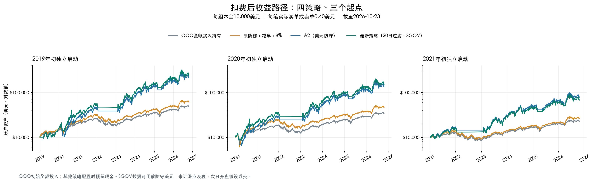
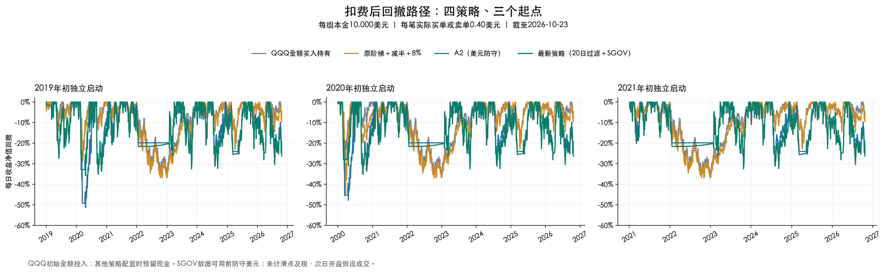
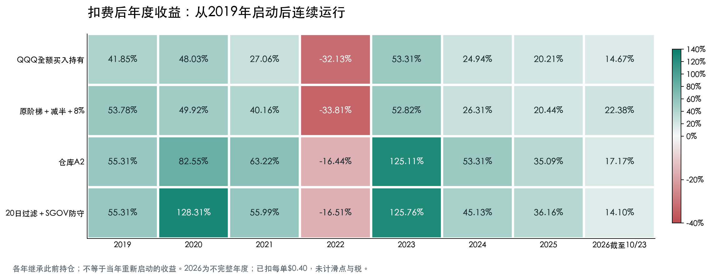

# QQQ / TQQQ / SGOV：20日过滤＋SMA200缓冲

最新研究策略：QQQ完整收盘同时高于SMA200上方1%及20日峰值的92%才新买TQQQ；普通配置60% TQQQ＋40% QQQ，均线防守后的首次恢复全配可投资部分TQQQ；均线下方1%转SGOV防守，20日峰值回落8%清TQQQ转QQQ。

**本页所有最新成绩与图均已按每笔实际买单或卖单0.40美元扣费。** 本金10,000美元，允许小数股，统一截至2026-10-23，不加入连续3日确认。0.40美元是研究假设，不代表IBKR实际费率；仍未计滑点与个人税。

## 最新策略：三个独立起点

| 起点 | 扣费后CAGR | 最大回撤 | Sharpe | 期末资产（美元） | 订单数 | 累计费用（美元） |
| --- | --- | --- | --- | --- | --- | --- |
| 2019 | 49.85% | -35.74% | 1.15 | 235,058 | 67 | 26.80 |
| 2020 | 48.70% | -33.67% | 1.13 | 148,843 | 63 | 25.20 |
| 2021 | 39.02% | -32.56% | 1.01 | 67,566 | 43 | 17.20 |

2019、2020起点新版同时改善A2的收益与最大回撤；2021起点新版年化39.02%低于A2的41.88%，回撤同为约32.56%，不是所有区间都更好。SGOV数据可用前用美元防守过渡，没有补造早期收益；新版实际首次买SGOV在2022年，因此2020避损主要来自入场过滤。

## 扣费后收益路径

同一本金、三个独立启动起点；账户资产使用对数坐标。[收益及回撤合并高清图](assets/sgov-fee040-equity-drawdown-by-start.png) · [合并SVG](assets/sgov-fee040-equity-drawdown-by-start.svg)。

## 扣费后回撤路径

按每日收盘净值计算。2019起点新版疫情回撤仍为35.74%；2020起点新版全区间最深回撤发生2020年9—10月；2021起点A2与新版最深回撤均在2023年7—10月。

## 扣费后年度收益图

从2019年连续运行，各年继承此前持仓，不等于当年重新启动；2026截至10月23日。

## 最新策略规则

| 项目 | 最新策略规则 |
| --- | --- |
| 版本 | `sma200-rolling20-guard-sgov-v1`；固定0.40美元/单研究口径 |
| 本金及交易标的 | 初始10,000美元，不追加；交易QQQ、TQQQ、SGOV，允许非整数股 |
| 信号 | 只用QQQ已完成交易日收盘C；SGOV不参与股票趋势判断 |
| SMA200（M） | 最近200个交易日QQQ收盘均值，包含信号日；不足200根完整日线不产生信号 |
| 20日峰值（H20） | 最近20个交易日最高收盘，包含信号日及窗口内入场前历史；不用High、不锁定、不在买入时重置 |
| 初始持仓 | 首日预留现金后买QQQ；首个收盘判断，下一交易日执行，预热历史不继承仓位 |
| 新买TQQQ的共同条件E | **C > M×1.01，并且C > H20×0.92**；两个条件均严格大于，等号不入场 |
| 普通入场 | 当前QQQ状态满足E，可投资资产配置60% TQQQ＋40% QQQ |
| 普通入场受阻 | 继续持QQQ，不改为SGOV |
| 均线防守 | **C ≤ M×0.99**：清掉QQQ和TQQQ，预留美元后全部可投资资产买SGOV；仅持QQQ也执行 |
| 防守等待 | 持SGOV等待E；条件不满足就保持，不因连续处于均线下方而每天买卖SGOV |
| 防守后首次恢复 | 因均线退出进入SGOV后，后续新收盘满足E：卖SGOV，可投资资产100%配置TQQQ，消耗本周期恢复资格 |
| 100%周期 | 持续至移动退出或均线退出；豁免70%漂移控制，不是风险或保证金豁免 |
| 8%移动退出 | 持TQQQ且**C ≤ H20×0.92**，清掉全部TQQQ、转QQQ；不转SGOV，无须先盈利，下跌恰好8%也退出 |
| 移动退出后重入 | 下一次或后续新收盘满足E，普通60/40买回；单独移动退出不产生100%恢复资格 |
| 退出优先级 | 均线防守＞移动退出＞新入场＞普通混合仓漂移调整；同时触发两种退出时最终SGOV防守 |
| 冷却和确认 | 无连续3日确认，无额外冷却；不要求当天刚从下往上穿线；同一收盘最多一个动作，不能退出后立即买回 |
| 普通漂移 | TQQQ真实收盘市值/账户净值严格超过70%，下一交易日调回可投资部分60% TQQQ＋40% QQQ；等于70%不调，不是减半 |
| 阶梯及前高减半 | 新策略不使用；原阶梯＋前高减半＋8%仅作为独立历史对照 |
| 美元预留 | 每次配置预留max(20美元,可交易净值×2%)，这部分保留美元，不也买成SGOV |
| 100%含义 | 预留现金后可投资部分全配目标ETF；10,000美元零费示意为9,800美元ETF＋200美元现金，实际还需扣该批订单费用 |
| 固定手续费 | 每笔实际非零买单或卖单0.40美元，含初始化；切换两只ETF通常两单共0.80美元；不向分红/持仓收费，不叠加比例费用 |
| 分红 | 除息日应收计净值、支付日转美元现金；不自动复投、不为分红单独交易；下次策略配置使用已到账现金 |
| 执行 | 收盘确认、下一交易日开盘先卖后买；按实际可用资金预算；研究假设全部成交 |
| 交易精度及融资 | 研究向下取整至0.000001股，不代表券商精度认证；不借款、不做空 |

“每次均线防守后的首次”是每个防守周期各一次，非账户终生一次。SGOV分红到账不产生恢复资格；只有均线防守状态满足E才转全TQQQ。滚动20日峰值会随旧高点移出下降，8%不是账户最多亏损8%。

| 当前状态 | 下一步 |
| --- | --- |
| QQQ | 满足E进普通60/40；触发均线防守则转SGOV；否则持QQQ |
| SGOV防守 | 满足E进入100% TQQQ周期；否则保持SGOV |
| 普通60/40 | 均线退出转SGOV、8%退出转QQQ、TQQQ超过70%时回60%目标 |
| 100% TQQQ周期 | 均线退出转SGOV，8%退出转QQQ；不因超过70%而减仓 |

## 四策略同步回测：已扣0.40美元/单

| 起点 | 策略 | 扣费后CAGR | 最大回撤 | Sharpe | 期末资产（美元） | 订单数 | 累计费用（美元） |
| --- | --- | --- | --- | --- | --- | --- | --- |
| 2019 | QQQ全额买入持有 | 22.20% | -34.64% | 0.97 | 47,817 | 1 | 0.40 |
| 2019 | 原阶梯＋减半＋8% | 26.03% | -36.89% | 1.04 | 60,849 | 49 | 19.60 |
| 2019 | A2（美元防守） | 47.82% | -51.37% | 1.10 | 211,232 | 120 | 48.00 |
| 2019 | 最新策略（20日过滤＋SGOV） | 49.85% | -35.74% | 1.15 | 235,058 | 67 | 26.80 |
| 2020 | QQQ全额买入持有 | 19.49% | -34.78% | 0.85 | 33,601 | 1 | 0.40 |
| 2020 | 原阶梯＋减半＋8% | 25.26% | -44.89% | 0.85 | 46,309 | 43 | 17.20 |
| 2020 | A2（美元防守） | 46.37% | -47.75% | 1.07 | 133,671 | 116 | 46.40 |
| 2020 | 最新策略（20日过滤＋SGOV） | 48.70% | -33.67% | 1.13 | 148,843 | 63 | 25.20 |
| 2021 | QQQ全额买入持有 | 15.28% | -34.93% | 0.75 | 22,807 | 1 | 0.40 |
| 2021 | 原阶梯＋减半＋8% | 18.12% | -36.90% | 0.82 | 26,268 | 31 | 12.40 |
| 2021 | A2（美元防守） | 41.88% | -32.56% | 1.06 | 76,025 | 55 | 22.00 |
| 2021 | 最新策略（20日过滤＋SGOV） | 39.02% | -32.56% | 1.01 | 67,566 | 43 | 17.20 |

订单数包括初始化以及每条QQQ/TQQQ/SGOV买卖，**累计费用=订单数×0.40美元**。费用在成交时扣现金，先预算整批费用再买入，随后份额、分红及净值重新计算，不是从旧期末金额简单减总费。

2019起点新版直接手续费26.80美元，期末资产比零费版少199.81美元，包含少投入份额的后续收益与分红影响。固定费使新版三个起点年化分别减少约0.016/0.022/0.018个百分点，未改变比较排序。

## 年度收益明细

单位为%，2019年启动后连续运行：

| 策略 | 2019 | 2020 | 2021 | 2022 | 2023 | 2024 | 2025 | 2026截至10/23 |
| --- | --- | --- | --- | --- | --- | --- | --- | --- |
| QQQ全额买入持有 | 41.85 | 48.03 | 27.06 | -32.13 | 53.31 | 24.94 | 20.21 | 14.67 |
| 原阶梯＋减半＋8% | 53.78 | 49.92 | 40.16 | -33.81 | 52.82 | 26.31 | 20.44 | 22.38 |
| A2（美元防守） | 55.31 | 82.55 | 63.22 | -16.44 | 125.11 | 53.31 | 35.09 | 17.17 |
| 最新策略（20日过滤＋SGOV） | 55.31 | 128.31 | 55.99 | -16.51 | 125.76 | 45.13 | 36.16 | 14.10 |

## 结果文件与方法

| 文件 | 内容 |
| --- | --- |
| [最新策略详解](docs/sgov-strategy.md) | 指标、状态、资格、优先级、SGOV分红与现金预留 |
| [扣费后详细回测报告](docs/sgov-backtests.md) | 毛净对照、回撤日期、费用及执行边界 |
| [四策略聚合CSV](results/sgov-fee040-comparison-2026-10-25.csv) | 12组扣费后收益、回撤、Sharpe、期末资产和费用 |
| [全部起点年度CSV](results/sgov-fee040-annual-2026-10-25.csv) | 各起点逐年扣费后收益 |
| [费用影响CSV](results/sgov-fee040-fee-impact-2026-10-25.csv) | 零费与0.40美元版本的年化和期末差额 |
| [逐年订单及费用](results/sgov-fee040-annual-orders-2026-10-25.csv) | 年度订单数及累计收费 |
| [回撤峰谷与恢复](results/sgov-fee040-drawdown-2026-10-25.csv) | 各策略最大回撤日期 |
| [来源、规则与验证元数据](results/sgov-fee040-metadata-2026-10-25.json) | 冻结口径、源文件哈希、发布产物哈希及验证范围 |

| 项目 | 本轮口径 |
| --- | --- |
| 起止 | 2019-01-02、2020-01-02、2021-01-04分别初始化；均截至2026-10-23，2026非完整年度 |
| QQQ基准 | 初始本金减0.40美元建仓费后全买QQQ，分红留现金；不是旧98%QQQ＋2%现金基准 |
| 其他策略 | 沿用配置时至少20美元或2%现金预留；与QQQ同本金、同行情、同分红会计，但持仓规则不同 |
| 行情 | QQQ自2021-10-25、TQQQ/SGOV自2021-10-27使用IBKR缓存，更早Yahoo补齐；不是全区间纯IBKR撮合 |
| SGOV历史 | 发行商成立日2020-05-26，本次可核验日线自2020-06-01；此前防守美元，不拼造历史；2021起点全段有SGOV数据 |
| 分配核验 | QQQ/TQQQ结合Nasdaq公司行动；SGOV75笔分配按iShares除息日、支付日及金额核验；不在总收益复权价格上重复加分红 |
| 费用 | 四策略每笔实际订单统一0.40美元，包括初始化；不是IBKR实际费率认证；期末不强制平仓、不预扣未发生的卖出费 |
| 现金及税 | 美元现金零息；未计点差、滑点与个人税；ETF实际价格已反映基金运行影响，不重复扣年费 |
| 成交假设 | 次日开盘全额成交、卖出回款可用；未模拟拒单、部分成交、结算、人工延迟与真实撮合 |
| CAGR | 按首末日期间日历年数计算复合年化，不是年度收益算术平均 |
| 最大回撤 | 每日收盘账户净值相对历史峰值下降幅度，包含初始本金基准；不是盘中最差损失 |
| Sharpe | 日收益标准差ddof=1、252日年化、无风险利率0 |
| 样本 | 三个起点高度重叠且已用于研究，不是三个独立未见样本外试验 |
| 发布与实盘 | 本次公开规则、图及聚合数据；本地计费引擎和冻结原始行情未随本次发布；新策略尚未接入IBKR实盘 |

本地研究完成51项相关单元测试；零费12组复现上轮四策略摘要；24组全部交易日独立重放现金、股数、分红应收及净值，费用总额与实际订单数一致；费前费后本样本订单及信号序列保持一致。**这些是本地研究验证，不是当前GitHub代码可完整复算新图表或IBKR实盘已验收的声明。**

## 历史版本与现有代码

| 入口 | 版本边界 |
| --- | --- |
| [A2历史规则](docs/a2-strategy.md) / [A2历史研究](docs/a2-backtests.md) | 美元防守、没有新增8%入场过滤；旧报告主表为毛收益，不混作本页扣费成绩 |
| [A2信号代码](research/sma200_mixed_rolling20.py) / [边界测试](tests/test_sma200_mixed_rolling20.py) | **仍是旧A2，尚未迁移到本页SGOV新策略** |
| [原阶梯规则](docs/strategy.md) / [历史回测](docs/backtests.md) | 前高锁定、阶梯、减半及周期解锁；不是本页新策略 |
| [发布前README归档](docs/history-readme-before-sgov.md) | 保留原A2展示及旧数字 |
| [老虎原生源码](strategies/tiger/main.py) | 独立252日历史版，不代表本页新策略已上线 |
| [历史IBKR费用记录](docs/ibkr-fees.md) | 订单预览证据；本页0.40美元是用户假设，未改写实际费率结论 |

本次更新策略说明、图表及聚合数据，不启动交易、不变更券商账户设置。原创代码和文档沿用[MIT](LICENSE)，第三方行情与资料遵循原条款。历史回测不保证未来收益。
