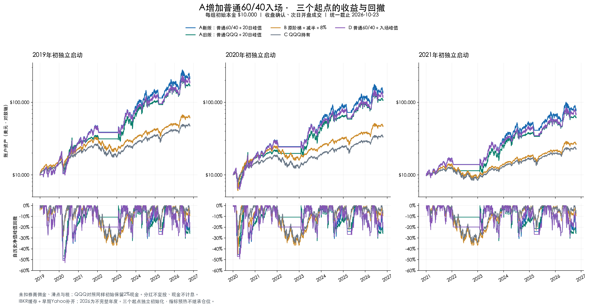

# 历史README：SGOV及固定费用版发布前

以下归档A2现金防守版，原主表未扣费用。最新规则见[SGOV策略](sgov-strategy.md)，最新扣费结果见[回测报告](sgov-backtests.md)。

# QQQ / TQQQ：SMA200缓冲＋普通60/40＋恢复全TQQQ

用QQQ完整收盘判断趋势：下行跌破均线缓冲线时持现金，上行普通持有60% TQQQ＋40% QQQ，均线清仓后首次恢复时全配可投资部分TQQQ，再用QQQ的20日峰值8%移动退出管理杠杆。

当前展示版本为 **A2／`sma200-mixed-rolling20-v2`**，更新于2026-10-25。本仓库同时保留原阶梯＋前高减半＋8%退出作为历史对照。**A2已完成本地研究与信号测试，尚未接入IBKR实盘；原老虎源码及旧研究入口仍运行各自历史规则。**

## 成果展示：最新A2的三个独立起点

每组本金**10,000美元**，统一截止**2026-10-23**，主表为**未扣券商佣金、滑点及税费**的历史研究结果。

| 起点 | CAGR | 最大回撤 | Sharpe | 期末资产（美元） | 订单腿数 |
| --- | --- | --- | --- | --- | --- |
| 2019 | 47.85% | -51.34% | 1.10 | 211,642 | 120 |
| 2020 | 46.42% | -47.70% | 1.07 | 134,037 | 116 |
| 2021 | 41.90% | -32.56% | 1.06 | 76,099 | 55 |

新版A2在本轮五个版本中毛CAGR最高；2019、2020起点最大回撤分别达**51.34%和47.70%**。这支持“更高杠杆暴露带来更高历史收益”，不代表降低了所有时期的风险或未来收益保证。



图上排为账户美元资产（对数轴），下排为每日收盘回撤。蓝线A新版、绿线A旧版、橙线B原阶梯、灰线QQQ、紫线D上次规则。[打开高清原图](../assets/a2-equity-drawdown-by-start.png)。


## 最新A2策略规则

| 项目 | 执行规则 |
| --- | --- |
| 版本 | `sma200-mixed-rolling20-v2`，简称A2／A新版；更新于2026-10-25 |
| 信号标的 | QQQ；所有判断只使用已经完成的日线收盘 |
| 交易标的 | 普通混合仓为QQQ与TQQQ；防守状态持美元现金 |
| 初始本金 | 每个独立回测起点10,000美元；不追加资金 |
| 初始持仓 | 首日开盘先预留现金、其余买QQQ；首个收盘再判断，下一交易日执行；预热历史不继承仓位 |
| SMA200 | QQQ最近200个交易日收盘价算术均值，**包含信号日**；不足200根停止判断 |
| 入场线 | `QQQ收盘 > SMA200 × 1.01`，严格大于；等于不入场 |
| 普通入场 | 当前无TQQQ、处于QQQ状态、没有尚未使用的均线清仓恢复资格，满足入场线后配置**60% TQQQ＋40% QQQ** |
| 均线全清仓 | `QQQ收盘 ≤ SMA200 × 0.99`，清空QQQ和TQQQ，持现金；仅持QQQ时也执行 |
| 清仓后首次买回 | 只有经过均线全清仓进入现金状态后，后续收盘满足入场线，配置**100% TQQQ**；买回即消耗本次资格 |
| 100%周期 | 持有TQQQ直至移动退出或均线全清仓；期间豁免70%漂移控制 |
| 20日峰值 | QQQ最近20个交易日的最高**收盘价**，包含信号日和窗口内入场前数据；不用High，不在入场时重置 |
| 移动退出 | 持有TQQQ时，`QQQ收盘 ≤ 20日峰值 × 0.92`，清全部TQQQ并转QQQ；下跌恰好8%也退出，无须先盈利 |
| 退出优先级 | 均线全清仓＞移动退出＞入场＞普通漂移调整；两种退出同时满足时最终持现金 |
| 移动退出后 | 后续新的收盘再次满足入场线，可以普通60/40买回；不要求再次均线全清仓，也不额外等待冷却期 |
| “满足”含义 | 不要求当天从线下新上穿；只要当前无TQQQ、后续新收盘严格高于入场线即可 |
| 同一信号 | 最多一个动作，不能先退出又用同一收盘立即买回；下一收盘可以重新入场 |
| 普通混合仓漂移 | TQQQ真实收盘市值／账户收盘净值**严格超过70%**，次日调回可投资部分60% TQQQ＋40% QQQ；不是减半 |
| 漂移例外 | 等于70%不调整；100% TQQQ周期不执行此控制；其他时间允许权重自然漂移，不每天强制60/40 |
| 现金预留 | 每次配置预留`max(20美元, 可交易净值×2%)`；10,000美元时先留200美元，60/40目标约为5,880美元TQQQ＋3,920美元QQQ |
| “100%”含义 | 预留现金后的可投资部分全配TQQQ，10,000美元账户约9,800美元TQQQ＋200美元现金，不代表账户净值100%投入 |
| 小数股 | 研究允许非整数股，模拟向下取整至0.000001股；该精度不是IBKR实盘下单精度认证 |
| 成交时间 | 信号日收盘确认，下一交易日开盘先卖后买；本轮研究假设全额成交 |
| 账户融资 | 不借款、不做空；TQQQ自身仍有每日杠杆及复利路径风险 |


### 四个状态与资格

| 状态 | 持仓含义 | 入场资格与后续动作 |
| --- | --- | --- |
| `QQQ` | 可投资部分仅持QQQ | 满足上方入场线，进入普通`MIXED`；跌破下方退出线，转`CASH` |
| `CASH` | 均线全清仓后的现金 | 等待上方入场线，首次买回进入`BOOST` |
| `MIXED` | 普通60% TQQQ＋40% QQQ，随后允许漂移 | 均线退出、20日峰值8%退出、超70%调回60% |
| `BOOST` | 均线恢复后的可投资部分100% TQQQ | 均线退出或20日峰值8%退出；不因权重超过70%减仓 |


“均线全清仓后的首次”是**每次均线清仓周期的首次恢复**，不是账户一生仅一次。只因8%移动退出而转QQQ，不会获得下一次100%资格；仍可按普通60/40重新入场。A2不使用下跌阶梯加仓或恢复前高减半；普通超70%调回60%也不是减半。

### 一天的判断顺序

| 顺序 | 检查 | 满足后的动作 |
| --- | --- | --- |
| 1 | 收盘≤SMA200×0.99 | 全清现金，后续条件不再判断 |
| 2 | 持TQQQ且收盘≤20日最高收盘×0.92 | 转QQQ，后续条件不再判断 |
| 3 | 无TQQQ且收盘>SMA200×1.01 | CASH进入全TQQQ；QQQ进入60/40 |
| 4 | 普通混合仓真实TQQQ权重>70% | 调回60/40 |
| 5 | 其余 | 保持当前仓位 |

## 五个版本分别比较什么

| 版本 | 普通配置／入场 | 均线防守与恢复 | TQQQ移动退出 | 退出后重新入场 |
| --- | --- | --- | --- | --- |
| **A新版（A2）** | 普通60% TQQQ＋40% QQQ | SMA200±1%现金缓冲；清仓后首次买回100% TQQQ | 最近20日最高收盘回落8% | 后续新收盘满足入场线，普通60/40买回 |
| A旧版 | 普通仅QQQ | 同上 | 最近20日最高收盘回落8% | 必须先经历新一轮均线清仓、恢复才再买TQQQ |
| B 原阶梯 | 以前20日最高High锁定前高，下跌分档加TQQQ | 没有SMA200现金防守 | 恢复前高减半实际份额，**减半后**才8%退出 | 按原锁定峰值恢复解锁，不直接普通60/40买回 |
| C QQQ持有 | 初始98% QQQ＋2%现金，固定股数 | 无 | 无 | 无 |
| D 上次规则 | 普通60% TQQQ＋40% QQQ | 同A2；清仓后首次买回100% TQQQ | **本轮入场以来最高收盘**回落8% | 同A2，普通60/40买回 |


A2与D的核心规则差异已收敛为**滚动20日峰值**与**入场以来峰值**；初始状态、均线缓冲、普通入场、100%周期和漂移控制保持一致。B本轮采用原仓库`research-20d-v1`交易语义，在统一会计口径下重放，不能直接混用历史旧表。

## 多策略、三个起点的完整对比

| 起点 | 策略 | CAGR | 最大回撤 | Sharpe | 期末资产（美元） | 订单腿数 |
| --- | --- | --- | --- | --- | --- | --- |
| 2019 | A新版 | 47.85% | -51.34% | 1.10 | 211,642 | 120 |
| 2019 | A旧版 | 43.50% | -48.89% | 1.10 | 167,630 | 25 |
| 2019 | B 原阶梯 | 26.04% | -36.89% | 1.04 | 60,903 | 49 |
| 2019 | C QQQ持有 | 21.95% | -34.39% | 0.97 | 47,063 | 1 |
| 2019 | D 上次规则 | 45.28% | -52.90% | 1.06 | 184,502 | 57 |
| 2020 | A新版 | 46.42% | -47.70% | 1.07 | 134,037 | 116 |
| 2020 | A旧版 | 41.41% | -38.27% | 1.08 | 105,744 | 17 |
| 2020 | B 原阶梯 | 25.27% | -44.87% | 0.85 | 46,353 | 43 |
| 2020 | C QQQ持有 | 19.24% | -34.41% | 0.85 | 33,131 | 1 |
| 2020 | D 上次规则 | 43.50% | -49.38% | 1.03 | 116,848 | 53 |
| 2021 | A新版 | 41.90% | -32.56% | 1.06 | 76,099 | 55 |
| 2021 | A旧版 | 36.65% | -32.56% | 1.05 | 61,139 | 11 |
| 2021 | B 原阶梯 | 18.14% | -36.89% | 0.82 | 26,289 | 31 |
| 2021 | C QQQ持有 | 15.06% | -34.38% | 0.75 | 22,552 | 1 |
| 2021 | D 上次规则 | 38.82% | -29.89% | 1.02 | 66,987 | 36 |

数据：[完整聚合CSV](../results/a2-comparison-2026-10-25.csv)、[全部起点年度收益CSV](../results/a2-annual-2026-10-25.csv)、[方法与来源元数据](../results/a2-metadata-2026-10-25.json)。Sharpe无风险利率为0，最大回撤按每日收盘计算；订单腿数不是信号次数。

## 逐年收益：2019年启动后连续运行

下表单位为%。各年继承前一年持仓；例如本表2021年收益不等于2021年初重新启动的首年收益。完整三个起点见年度CSV。

| 策略 | 2019 | 2020 | 2021 | 2022 | 2023 | 2024 | 2025 | 2026截至10/23 |
| --- | --- | --- | --- | --- | --- | --- | --- | --- |
| A新版 | 55.36 | 82.80 | 63.25 | -16.44 | 125.12 | 53.33 | 35.09 | 17.17 |
| A旧版 | 55.36 | 75.74 | 26.79 | -9.46 | 125.12 | 42.21 | 45.96 | 14.46 |
| B 原阶梯 | 53.84 | 49.95 | 40.17 | -33.81 | 52.82 | 26.32 | 20.45 | 22.38 |
| C QQQ持有 | 41.02 | 47.34 | 26.80 | -31.88 | 52.72 | 24.76 | 20.10 | 14.60 |
| D 上次规则 | 55.36 | 81.03 | 62.51 | -16.44 | 107.83 | 46.09 | 30.17 | 22.24 |

## 已观察到的代价与交易冲突

| 观察 | 本轮证据 | 含义 |
| --- | --- | --- |
| 普通入场补回牛市杠杆 | 2019连续起点的2021收益：旧A26.79%→新版A63.25% | 新版不再全年仅持QQQ |
| 熊市代价同时增加 | 同一条路径的2022收益：旧A−9.46%→新版A−16.44% | 普通混合仓在均线退出前仍承担TQQQ风险 |
| 起点改变损失 | 新版2019/2020/2021最大回撤：51.34%／47.70%／32.56% | 2020疫情前是否已进入全TQQQ周期会影响回撤，不能只展示较好起点 |
| 订单显著增加 | 新版120／116／55腿；旧A25／17／11腿 | 买卖每条腿分别累计，包含初始化；一次ETF切换通常两腿 |
| 滚动峰值可能下降 | 旧高点移出20日窗口，退出参考线随之下降 | 可容忍慢跌，不能当成固定亏损上限；2021起点最深回撤发生在2023年7月至10月 |
| 买回与退出可能冲突 | 2024-07-26退出→07-29买回→07-31退出→08-01买回→08-02退出，8月仍反复 | 入场只要求高于均线，而价格相对20日旧高点仍可能回撤≥8%；本版未加冷却或额外过滤 |

单列每买卖腿成交额0.1%的**假设摩擦压力**时，新版三个起点CAGR降至46.37%／44.86%／41.03%，分别比主表低约1.48／1.57／0.87个百分点。该数字用于观察换手风险，**不是IBKR账户的实际佣金模型**。实际费率核实仍见[历史费用记录](ibkr-fees.md)。


## 回测口径与证据边界

| 项目 | 本轮口径与限制 |
| --- | --- |
| 研究日期／截止 | 2026-10-25计算；市场数据统一截至2026-10-23 |
| 起点 | 2019-01-02、2020-01-02、2021-01-04分别独立初始化；起点前历史只预热指标 |
| 行情来源 | QQQ从2021-10-25、TQQQ从2021-10-27起使用IBKR缓存；更早Yahoo补齐；分红结合Nasdaq公司行动记录。**不是全区间纯IBKR回测** |
| 费用 | 主表未扣券商佣金、滑点、税费；不能将原小额订单预览外推为所有历史订单实际费率 |
| 分红／现金 | 分红除息应收计入净值，支付日进入现金，不复投；现金不计息；QQQ对照也保留初始2%现金 |
| 拆股 | 历史名义价格及实际股数匹配；不把拆股当收益 |
| 执行假设 | 次日开盘全额成交、卖出回款可用；历史跳空由开盘价体现，未模拟拒单、部分成交、人工延迟、结算限制或实际撮合滑点 |
| CAGR | 按首末日期间的日历年数计算复合年化，不是年度收益算术均值 |
| 最大回撤 | 账户每日收盘净值相对历史峰值下降幅度，含初始本金基准；**不是盘中最大损失** |
| Sharpe | 日收益标准差`ddof=1`、252日年化、无风险利率0 |
| 年度收益 | 年末净值／上年末净值−1；首年从本金起算。2026年截至10月23日，不是完整自然年 |
| 数据质量 | 原缓存保留5根OHLC区间异常；全Yahoo替代检查中15组CAGR最大变化约0.0126个百分点，主表CAGR排序未变 |
| 验证范围 | 本地信号测试和会计回放；没有IBKR实盘成交、实际费用或老虎平台对最新版A的验收 |
| 样本性质 | 三个起点区间高度重叠，且均已用于研究；不是三个独立、未见过的样本外试验 |
| 公开复现范围 | 本仓库公开规则、纯信号代码、测试、聚合CSV及图表；冻结原始行情和本地会计运行器未随本次发布，不能仅运行旧研究入口精确复算本表 |


## 样例：只验证信号，不连接券商

Python 3.10+，在仓库根目录安装现有研究依赖后运行测试：

```bash
git clone https://github.com/score2021/qqq-tqqq-ladder-strategy.git
cd qqq-tqqq-ladder-strategy
python3 -m venv .venv
source .venv/bin/activate
python -m pip install -r requirements.txt
python -m unittest discover -s tests -p test_sma200_mixed_rolling20.py -v
```

以下使用合成数值演示四种信号，不下载行情、不写持仓文件、不下订单：

```python
from research.sma200_mixed_rolling20 import Position, decide

cases = [
    ("普通入场", Position.QQQ, 102, 100, 102, 0),
    ("现金恢复", Position.CASH, 102, 100, 102, 0),
    ("移动退出", Position.MIXED, 110, 100, 120, 0.6),
    ("普通漂移", Position.MIXED, 110, 100, 115, 0.71),
]
for label, state, close, sma200, peak20, weight in cases:
    decision = decide(state, close, sma200, peak20, weight)
    print(label, decision.position.value, decision.target, decision.reason)
```

对应输出为本地实际验证的合成信号结果；目标仅是下一开盘意图，调用者须在真实成交确认后再更新状态：

```text
普通入场 MIXED (0.4, 0.6) MIXED_ENTRY
现金恢复 BOOST (0.0, 1.0) MA_REENTER_TQQQ
移动退出 QQQ (1.0, 0.0) ROLLING20_EXIT
普通漂移 MIXED (0.4, 0.6) DRIFT_CAP
```

本地研究完成12个新信号边界测试；信号及会计适配器合计87条语句覆盖率100%，不等于分支覆盖或实盘可靠性证明。旧A/B/C/D全部12组摘要精确复现；A2逐日净值与独立旧D执行循环仅替换20日峰值后的结果一致；检查了年度复利、次日执行、资金非负、历史前缀和未来价格扰动。详细证据边界见[最新回测报告](a2-backtests.md)。

## 文件与历史资料

| 入口 | 内容 |
| --- | --- |
| [A2详细规则](a2-strategy.md) | 指标、状态、优先级、重新入场、漂移和现金例子 |
| [A2详细回测报告](a2-backtests.md) | 最新五版本比较、收益路径、换手与限制 |
| [A2纯信号模块](../research/sma200_mixed_rolling20.py) | 不连接券商的状态决策函数 |
| [A2边界测试](../tests/test_sma200_mixed_rolling20.py) | 入场资格、阈值等号、退出优先级、70%豁免和重入 |
| [旧A与共用指标](../research/sma200_rolling20.py) | 普通QQQ旧版本及SMA200／20日峰值计算 |
| [原阶梯规则](strategy.md) | 历史阶梯和老虎版边界 |
| [历史回测报告](backtests.md) | 旧资金、旧费用口径的阶梯研究，独立阅读 |
| [发布前README归档](history-readme-before-a2.md) | 历史用法、老虎入口及旧费用说明 |
| [IBKR费用记录](ibkr-fees.md) | 历史订单预览证据及尚未核实事项 |

原创代码和文档按现有[MIT许可证](../LICENSE)发布。第三方行情及链接内容受各自条款约束，本次不分发原始行情。历史回测不保证未来收益。
