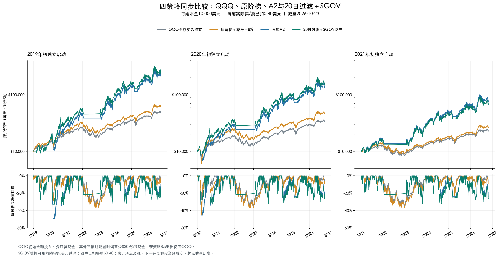

# 新策略与三个对照：固定0.40美元/单

研究日2026-10-25，每组初始10000美元；三个起点2019-01-02、2020-01-02、2021-01-04，截止2026-10-23。新策略规则见[策略详解](sgov-strategy.md)。

## 全部扣费后结果

| 起点 | 策略 | 扣费后CAGR | 最大回撤 | Sharpe | 期末资产（美元） | 订单数 | 累计费用（美元） |
| --- | --- | --- | --- | --- | --- | --- | --- |
| 2019 | QQQ全额买入持有 | 22.20% | -34.64% | 0.97 | 47,817 | 1 | 0.40 |
| 2019 | 原阶梯＋减半＋8% | 26.03% | -36.89% | 1.04 | 60,849 | 49 | 19.60 |
| 2019 | A2（美元防守） | 47.82% | -51.37% | 1.10 | 211,232 | 120 | 48.00 |
| 2019 | 最新策略（20日过滤＋SGOV） | 49.85% | -35.74% | 1.15 | 235,058 | 67 | 26.80 |
| 2020 | QQQ全额买入持有 | 19.49% | -34.78% | 0.85 | 33,601 | 1 | 0.40 |
| 2020 | 原阶梯＋减半＋8% | 25.26% | -44.89% | 0.85 | 46,309 | 43 | 17.20 |
| 2020 | A2（美元防守） | 46.37% | -47.75% | 1.07 | 133,671 | 116 | 46.40 |
| 2020 | 最新策略（20日过滤＋SGOV） | 48.70% | -33.67% | 1.13 | 148,843 | 63 | 25.20 |
| 2021 | QQQ全额买入持有 | 15.28% | -34.93% | 0.75 | 22,807 | 1 | 0.40 |
| 2021 | 原阶梯＋减半＋8% | 18.12% | -36.90% | 0.82 | 26,268 | 31 | 12.40 |
| 2021 | A2（美元防守） | 41.88% | -32.56% | 1.06 | 76,025 | 55 | 22.00 |
| 2021 | 最新策略（20日过滤＋SGOV） | 39.02% | -32.56% | 1.01 | 67,566 | 43 | 17.20 |

## 毛净比较

下表列名cagr_drag_pp为年化下降百分点，final_wealth_drag为期末资产减少美元；累计手续费与复利影响不同。

| scheduled_start | strategy | gross_cagr_pct | net_cagr_pct | cagr_drag_pp | total_commission | final_wealth_drag |
| --- | --- | --- | --- | --- | --- | --- |
| 2019-01-02 | QQQ全额买入持有 | 22.19855 | 22.19793 | 0.00063 | 0.4 | 1.91267 |
| 2019-01-02 | 原阶梯＋减半＋8% | 26.04393 | 26.02977 | 0.01415 | 19.6 | 53.35454 |
| 2019-01-02 | A2（美元防守） | 47.85186 | 47.81509 | 0.03677 | 48.0 | 410.51338 |
| 2019-01-02 | 最新策略（20日过滤＋SGOV） | 49.86929 | 49.85298 | 0.01631 | 26.8 | 199.80696 |
| 2020-01-02 | QQQ全额买入持有 | 19.49135 | 19.49065 | 0.0007 | 0.4 | 1.34428 |
| 2020-01-02 | 原阶梯＋减半＋8% | 25.2742 | 25.25699 | 0.01721 | 17.2 | 43.31484 |
| 2020-01-02 | A2（美元防守） | 46.42487 | 46.36611 | 0.05876 | 46.4 | 365.6505 |
| 2020-01-02 | 最新策略（20日过滤＋SGOV） | 48.71846 | 48.69646 | 0.022 | 25.2 | 149.93831 |
| 2021-01-04 | QQQ全额买入持有 | 15.27966 | 15.27887 | 0.0008 | 0.4 | 0.91257 |
| 2021-01-04 | 原阶梯＋减半＋8% | 18.13847 | 18.12224 | 0.01624 | 12.4 | 20.94477 |
| 2021-01-04 | A2（美元防守） | 41.9038 | 41.87998 | 0.02382 | 22.0 | 74.05016 |
| 2021-01-04 | 最新策略（20日过滤＋SGOV） | 39.04132 | 39.02325 | 0.01807 | 17.2 | 50.92957 |

新策略直接费用26.80/25.20/17.20美元，期末资产分别比零费少199.81/149.94/50.93美元；A2对应直接费48.00/46.40/22.00美元，期末少410.51/365.65/74.05美元。本次所有12组费前后实际订单日期、标的和方向一致，只改变数量与后续会计，不是人为强制旧交易表。

## 年度收益：2019连续起点

| 策略 | 2019 | 2020 | 2021 | 2022 | 2023 | 2024 | 2025 | 2026截至10/23 |
| --- | --- | --- | --- | --- | --- | --- | --- | --- |
| QQQ全额买入持有 | 41.85 | 48.03 | 27.06 | -32.13 | 53.31 | 24.94 | 20.21 | 14.67 |
| 原阶梯＋减半＋8% | 53.78 | 49.92 | 40.16 | -33.81 | 52.82 | 26.31 | 20.44 | 22.38 |
| A2（美元防守） | 55.31 | 82.55 | 63.22 | -16.44 | 125.11 | 53.31 | 35.09 | 17.17 |
| 最新策略（20日过滤＋SGOV） | 55.31 | 128.31 | 55.99 | -16.51 | 125.76 | 45.13 | 36.16 | 14.10 |

2020新策略128.31%较A2的82.55%改善；2021新策略55.99%低于A2的63.22%，2024新策略45.13%低于A2的53.31%。2021独立起点的年化同样较低，不挑选最好起点作为统一结论。

## 收益与回撤路径

| scheduled_start | strategy | peak | trough | mdd_pct | recovery |
| --- | --- | --- | --- | --- | --- |
| 2019-01-02 | QQQ全额买入持有 | 2021-11-19 | 2022-11-03 | -34.6449% | 2023-12-13 |
| 2019-01-02 | 原阶梯＋减半＋8% | 2021-11-19 | 2022-11-03 | -36.8933% | 2024-01-19 |
| 2019-01-02 | A2（美元防守） | 2020-02-19 | 2020-04-21 | -51.3673% | 2020-07-20 |
| 2019-01-02 | 最新策略（20日过滤＋SGOV） | 2020-02-19 | 2020-04-21 | -35.7448% | 2020-06-08 |
| 2020-01-02 | QQQ全额买入持有 | 2021-11-19 | 2022-11-03 | -34.7795% | 2023-12-13 |
| 2020-01-02 | 原阶梯＋减半＋8% | 2020-02-19 | 2020-03-20 | -44.8855% | 2020-05-20 |
| 2020-01-02 | A2（美元防守） | 2020-02-19 | 2020-04-21 | -47.7464% | 2020-07-08 |
| 2020-01-02 | 最新策略（20日过滤＋SGOV） | 2020-09-02 | 2020-10-30 | -33.6711% | 2021-02-12 |
| 2021-01-04 | QQQ全额买入持有 | 2021-11-19 | 2022-11-03 | -34.9286% | 2023-12-13 |
| 2021-01-04 | 原阶梯＋减半＋8% | 2021-11-19 | 2022-11-03 | -36.8957% | 2024-01-19 |
| 2021-01-04 | A2（美元防守） | 2023-07-18 | 2023-10-26 | -32.5587% | 2023-12-12 |
| 2021-01-04 | 最新策略（20日过滤＋SGOV） | 2023-07-18 | 2023-10-26 | -32.5587% | 2023-12-12 |

新版最大回撤仍约32.56%—35.74%，不是8%。2019新版回撤略大于QQQ的34.64%；2020新版最深回撤发生9—10月；2021两均线策略最深回撤均在2023年7—10月。

## 过滤与SGOV的作用

上轮零费消融中，同一20日过滤美元版→SGOV版年化增加约0.52/0.59/0.65个百分点，未改变该样本最大回撤；本页新主表为固定0.40美元后成绩，不能把两组数字混称同一费用口径。新策略实际2022年才第一次持SGOV，2020收益及避损主要来自阻止8%退出区域内新买TQQQ。本次新版每个起点都有6条实际SGOV买卖订单，合计2.40美元固定费，已包含在主表总费用内。

## 方法与限制

| 项目 | 本轮口径 |
| --- | --- |
| 起止 | 2019-01-02、2020-01-02、2021-01-04分别初始化；均截至2026-10-23，2026非完整年度 |
| QQQ基准 | 初始本金减0.40美元建仓费后全买QQQ，分红留现金；不是旧98%QQQ＋2%现金基准 |
| 其他策略 | 沿用配置时至少20美元或2%现金预留；与QQQ同本金、同行情、同分红会计，但持仓规则不同 |
| 行情 | QQQ自2021-10-25、TQQQ/SGOV自2021-10-27使用IBKR缓存，更早Yahoo补齐；不是全区间纯IBKR撮合 |
| SGOV历史 | 发行商成立日2020-05-26，本次可核验日线自2020-06-01；此前防守美元，不拼造历史；2021起点全段有SGOV数据 |
| 分配核验 | QQQ/TQQQ结合Nasdaq公司行动；SGOV75笔分配按iShares除息日、支付日及金额核验；不在总收益复权价格上重复加分红 |
| 费用 | 四策略每笔实际订单统一0.40美元，包括初始化；不是IBKR实际费率认证；期末不强制平仓、不预扣未发生的卖出费 |
| 现金及税 | 美元现金零息；未计点差、滑点与个人税；ETF实际价格已反映基金运行影响，不重复扣年费 |
| 成交假设 | 次日开盘全额成交、卖出回款可用；未模拟拒单、部分成交、结算、人工延迟与真实撮合 |
| CAGR | 按首末日期间日历年数计算复合年化，不是年度收益算术平均 |
| 最大回撤 | 每日收盘账户净值相对历史峰值下降幅度，包含初始本金基准；不是盘中最差损失 |
| Sharpe | 日收益标准差ddof=1、252日年化、无风险利率0 |
| 样本 | 三个起点高度重叠且已用于研究，不是三个独立未见样本外试验 |
| 发布与实盘 | 本次公开规则、图及聚合数据；本地计费引擎和冻结原始行情未随本次发布；新策略尚未接入IBKR实盘 |

原阶梯按冻结提交05a7875700946d086f268747c0da1eb01a316982的research-20d-v1语义在统一会计下重放，未加入SMA200现金防守或普通60/40。原阶梯8%退出在恢复前高减半后才激活；A2与新版的20日峰值8%退出自持TQQQ即生效。A2来自更新前主分支094b0dd3ca56fa3781387d634596a3196e00fa22，最新规则在其上增加入场过滤和SGOV。

本地51项单元测试通过；0费12组摘要精确复现；24组全部交易日独立按订单、拆股、除息应收和支付现金重建现金/份额/净值一致；历史前缀及年度复利一致；全部非零订单严格扣0.40，分红与持有不收费。原始行情与本地完整计费运行器没有在本次发布，公开聚合表可审阅但不能仅运行旧research/compare.py精确复算本报告。

SGOV来源：[iShares](https://www.ishares.com/us/products/314116/ishares-0-3-month-treasury-bond-etf)；TQQQ每日杠杆说明：[ProShares](https://www.proshares.com/our-etfs/leveraged-and-inverse/tqqq)。SGOV月度分配用应收及支付日处理；价格和分红不重复计收益。发行商收益率不用于填充历史收益。

[全部结果文件索引](../README.md#结果文件与方法)。
