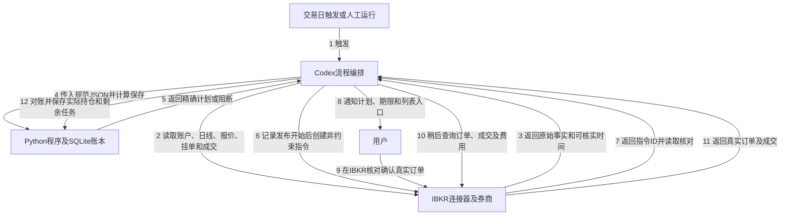

# IBKR辅助交易系统：设计与运行契约

设计于2026-10-25，代码验收于2026-10-26。规则版本`sma200-rolling20-guard-sgov-v1`，执行程序版本以Git提交为准，数据库schema版本1。用户已授权把会话设计落实为文档和代码。**当前交付可离线运行的计算、计划、账本及恢复程序，未认证实盘上线，没有启动定时任务或提交订单。**

## 系统边界与现状

采用本地Python＋SQLite账本＋Codex连接器编排＋IBKR人工确认。程序本身不含网络请求、券商凭证、submit/place_order入口。Codex读取券商数据、组织规范输入并按程序精确输出创建非约束指令；用户在IBKR核对并提交真实订单。不得让AI临时改数量、价格、方向或策略参数。

现有QQQ/TQQQ持仓先保留，不按空仓重置；先对账和影子运行，再确认迁移。默认SHADOW/UNINITIALIZED；此时可计算各状态的假设信号`SHADOW_ANALYSIS`，但不建立真实执行目标。确认周期不等于必须立刻调整现有比例，普通混合仓允许漂移。已存在的未知挂单先核对，不自动删除。

| 实测能力 | 结论与限制 |
| --- | --- |
| 账户 | 页面与持仓做过一次交叉核对；连接器响应没有账号，不能持续自动证明账户绑定 |
| 碎股 | 用户确认实际成交；三只ETF的0.123456非约束指令均创建、读取核对成功并清理；不据此认证SGOV实际成交权限或所有价格/数量步长 |
| 行情 | 当次周日行情FROZEN，缺买卖报价；last.ts不能当作买卖报价时间或正式收盘 |
| 关联 | 已有订单到成交的分组得到验证；AI指令到真实订单仍需开市验证，缺字段时人工明确绑定 |
| 链接和期限 | 三次返回同一指令列表链接，指令实际均保留约7天；链接不是唯一键，保留期不是DAY |

上表只公开能力结论，不发布真实账号、持仓、委托ID、资金快照或授权。`connector.inspect_quote`仅识别已观察到的冻结/缺失结构，对未知bid-ask结构返回`UNVERIFIED_BID_ASK_SCHEMA`，**没有编造实时字段适配**。开市实测明确买卖报价及其时间语义后才可实现该映射。规范输入中的`timestamp_verified=true`须有外部证据，不能仅编辑标志当作能力验收。

## 数据流与模块



| 模块 | 职责 |
| --- | --- |
| `trading_system/strategy.py` | Decimal纯核心，SMA200、20日峰值、严格边界、优先级 |
| `market.py` | XNYS日历、完整200根日线、时区、报价及数量基础校验 |
| `ledger.py` | SQLite事务、单写入锁、备份；区分状态、目标、计划、指令、订单、成交、资金事件和运行记录 |
| `service.py` | 信号、单步先卖后买、发布恢复、绑定、成交和资金对账 |
| `connector.py` | 连接器结果解码、已观察字段质量检查及无损数字序列化 |
| `__main__.py` | JSON CLI与退出码，不提供券商发送功能 |
| `research/sma200_sgov.py` | 研究直接复用同一纯信号核心，不另写一套规则 |

## 信号、周期与执行状态

策略详见[SGOV规则](sgov-strategy.md)。两窗口包含信号日；入场同时严格高于SMA200×1.01和H20×0.92；均线≤0.99清QQQ/TQQQ转SGOV；TQQQ持仓且≤H20×0.92转QQQ；普通60/40、漂移严格超过70%回60%；防守后首次100%TQQQ周期豁免漂移。无阶梯、前高减半、3日确认或额外冷却。

| 策略状态 | 转换 |
| --- | --- |
| UNINITIALIZED | 只登记事实/展示假设信号；确认资金、周期和账户后接纳，不重置历史资金事件 |
| QQQ_ONLY | E成立进MIXED；均线防守转SGOV |
| MIXED | 均线防守、8%退出、70%漂移控制 |
| BOOST | 均线防守或8%退出；没有70%控制 |
| DEFENSIVE | 满足E且恢复资格已确认后进BOOST |

策略目标、执行进度、资产事实分开保存。创建计划或AI指令不改持仓；实际成交才改。普通入场首次TQQQ部分成交进入MIXED；防守恢复首次TQQQ部分成交进入BOOST并消耗资格。均线清仓实际清掉两只风险资产即建立恢复资格，即便SGOV暂未买成。待完成目标继续保留；下次收盘出现更高优先级风险信号时，先查清旧指令/订单再替换。未成交的旧买入授权不跨日盲目沿用。

## 资金、价格与数量

- 规范快照只包含明确归属策略的三只ETF数量及策略现金；IREN等单独管理。券商可用已结算美元约束可买金额，不能用Buying Power替代。未知挂单或未证明完整的订单/指令列表阻断。
- 收盘权重使用有证据的收盘持仓、收盘价格、现金和应收；QQQ收盘价格必须与指标输入一致。订单准备使用新买卖报价估值。实际数量不能用回测目标权重反推。
- 每次分配保留max(20美元,可交易净值×2%)美元。另从可投资预算保守预留最多六笔订单的已确认费用上限（三资产最多分别买卖）；这是资金预算，**不是佣金扣费规则**。实际只按券商费用记账，未用预算留现金，不按成交片段重复收最低费。
- `fee_cap_per_order`默认null，必须根据券商预览/实际证据确认后才能准备可发布计划；0.40美元研究假设不自动成为实盘费率。后到费用只更新差额，缺费用显示pending。
- 先卖后买，每次只准备一笔；成交后重读资金。买入向上对齐ask价格步长，卖出向下对齐bid；数量按各标的核实步长向下取整。限价不保证成交，不自动追价。
- 初始执行参数为报价/快照30秒、计划300秒、最大买卖价差0.3%，并非收益优化结论；准备及发布前重复校验。`dust_usd=1`仅允许保留不超过1美元的目标分配残差，避免为舍入和费用反复交易；零目标风险仓位必须实际清零，不能以dust豁免退出。残差仍披露。
- 全部卖出处理完后冻结该批买入份额；资金不足就缩小本笔、保留剩余目标或WAIT_FUNDS，不融资。价格大幅变化造成目标无法完成时报告，不能伪称完成。
- 分红除息应收不用于交易；支付日记录净到账与应收结清，包含预扣差额，不自动DRIP。入出金以独立已确认事件登记，不重置周期，首版不因入金单独产生补仓目标。

## 发布、幂等与崩溃恢复

1. prepare保存PLANNED计划，包含策略版本、账户授权引用、信号日、实际持仓、精确参数、费用预算、报价时间及本地过期时间。
2. 立即重读事实并prepare复核。`record-external/publication_start`再次检查模式、停机文件、配置哈希、计划期限及刚校验的时间，持久化PUBLISHING后返回原样payload。
3. Codex才可调用`create_order_instruction`；用`tool_payload`转换数字表示，读取指令后核对完整payload，再记录instruction_receipt。URL是列表入口，ID才是标识。
4. 外部调用超时或进程在PUBLISHING期间退出，按UNKNOWN_PUBLICATION处理，先查询，不重发。只有查明指令不存在且用户明确确认没有真实订单，才可记录instruction_absent并重新准备。
5. 用户在IBKR核对账户、合约、数量、方向、限价、费用及DAY。缺少直接关联字段时，通过order_binding明确确认真实订单并核对参数。不能模糊匹配。
6. 按trade_id记实际成交；order_id负责分组。部分成交保留余量；成交撤销/数量价格更正、超额成交等需要人工复核，不当作新成交自动叠加。FILLED终态必须有全量成交证据。

没有券商客户端幂等键，不能保证外部创建恰好一次。单写入保护仅覆盖同一账本路径；禁止为同一策略资金同时运行多个独立账本副本。

本地计划过期不能令券商页面自动失效。过时AI指令应由编排方查询并经明确核对后清理；删除非约束指令不等于撤销真实订单。真实DAY未成交通常收市失效，但必须查询终态后再补单。已绑定订单不能用instruction_absent清理。

## 调度、延迟与异常

建议收盘后约20分钟对账并计算次日意图，次交易日09:35美东时间准备指令；提前收市和夏令时按日历。第一版不创建任务。需要本地文件的Codex定时任务要求电脑开机、应用运行且目录可访问；不是硬实时服务。

买入后后半夜的盘中波动不新增交易，正式收盘再判断、下一交易日执行；仍承担盘中跌幅及隔夜跳空。人工晚提交需重算。错过一天补齐指标历史，但不补演未发生的交易。程序停止期间券商真实订单仍可能成交，重启读取成交后再计划。

| 情况 | 返回/处理 |
| --- | --- |
| 无信号 | NO_ACTION，无指令 |
| 未确认周期 | SHADOW_ANALYSIS或BLOCKED，无目标 |
| 只计算 | SHADOW_PLAN，禁止publication_start |
| 等待人工/成交/资金 | WAIT_USER / WAIT_FILL / WAIT_FUNDS |
| 发布结果未知 | UNKNOWN_PUBLICATION，退出码4，查询后再处理 |
| 数据/账户/旧单冲突 | BLOCKED，退出码3 |
| 账本不符 | RECONCILE_REQUIRED，暂停计划 |
| 无法明确绑定 | 返回ORDER_BINDING_CONFIRMATION_REQUIRED，不猜关联 |

正常等待退出码0，输入/配置/文件错误2，阻断或对账异常3。没有HTTP服务，Apifox不适用。

## 本地运行与演示

Python 3.12；依赖与测试沿用项目工具：

```sh
python -m pip install -r requirements-system.txt -r requirements-dev.txt
python -m unittest discover -s tests -v
```

以下只有合成数据、不会调用IBKR。默认示例配置未确认任何实盘能力：

```sh
python -m trading_system --db runs/assisted-demo/state.sqlite --config config/assisted.example.json --input examples/assisted/bootstrap.json initialize
python -m trading_system --db runs/assisted-demo/state.sqlite --config config/assisted.example.json --input examples/assisted/signal.json --now 2026-10-26T13:35:00Z evaluate
python -m trading_system --db runs/assisted-demo/state.sqlite status
```

得到UNINITIALIZED及SHADOW_ANALYSIS，持仓原样保留。另用**纯合成已确认配置**验证完整计划：

```sh
python -m trading_system --db runs/assisted-synthetic/state.sqlite --config examples/assisted/shadow-config.json --input examples/assisted/bootstrap.json initialize
python -m trading_system --db runs/assisted-synthetic/state.sqlite --config examples/assisted/shadow-config.json --input examples/assisted/signal.json --now 2026-10-26T13:35:00Z evaluate
python -m trading_system --db runs/assisted-synthetic/state.sqlite --config examples/assisted/shadow-config.json --input examples/assisted/prepare.json --now 2026-10-26T13:35:00Z prepare
```

输出SHADOW_PLAN。演示中费用上限1美元、live和timestamp_verified等标志都是合成fixture，不能作为实盘证据。`--now`仅限SHADOW，REVIEW禁止用离线时钟覆盖实际时间。

真实配置保存为`config/*.local.json`或仓库外，账本放固定私有目录。配置binding_ref只是本地授权引用，不能当作连接器自动提供的账号。状态接纳通过record-external的migration_confirmation事件，要求confirmed、最新snapshot、phase和必要的recovery_eligible；不得仅根据比例猜BOOST。

备份使用SQLite一致性备份，不在运行时直接复制数据库文件：

```sh
python -m trading_system --db runs/assisted-demo/state.sqlite --output runs/assisted-demo/backup.sqlite backup
```

目标文件必须不存在，权限0600；恢复副本标记必须先对账。主库、备份、锁、原始账户输入、授权、通知及日志不得推送GitHub。程序不存券商密码；机器及磁盘保护由运行环境负责。

## 验收与上线门槛

本地58项测试通过（原有22＋新增36），整个新包语句覆盖率88%，策略核心100%；CLI合成演示和备份恢复通过。已配置CI验证全部unittest、编译及整个trading_system包语句覆盖率≥80%，不排除CLI来提高比例；云端结果以Actions记录为准。正式测试覆盖严格边界、先卖后买、SGOV→BOOST部分成交、重复回报、晚到费用、旧信号替换、未知发布、停机、备份恢复和时区/半日市。

上线顺序：核实账户/策略资金/周期/旧单 → 开市证明报价及时间语义 → 验证指令到真实订单关联 → 至少10个交易日影子运行 → 审阅具体迁移计划 → 开始人工确认模式。10日是工程观察期，不是盈利证明。真实买卖确认仍在IBKR完成。

不能把离线测试当实盘成交验收，也不能把09:35＋人工确认当作研究中的次日开盘全额成交。应对照券商订单、成交和现金流水，记录实际成交延迟、价格偏差、费用、拒单及漏执行。本次没有重跑首页历史图表；旧研究会计与新执行系统的差异仍需独立验证。

外部依据：[IBKR人工审阅AI指令](https://www.ibkrguides.com/traderworkstation/gen-ai-instructions.htm)、[DAY等期限说明](https://www.ibkrguides.com/traderworkstation/time-in-force-columns.htm)、[Codex本地定时任务条件](https://learn.chatgpt.com/docs/automations?surface=app)。
